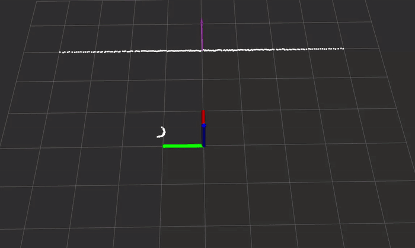

# Wall Pose Estimation from 2D LiDAR (ROS 2)

A ROS 2 perception node that estimates the **distance and orientation of a flat surface in front of a
drone** from a 2D LiDAR scan. A use case is contact-based inspection: before the drone touches a wall
with a sensor probe, it needs to know how far away the surface is and how it is rotated relative to it,
so it can approach perpendicularly.

The repository contains the ROS 2 package, unit tests, and a script that generates a realistic rosbag
(wall approach, yaw oscillation, sensor dropouts and a dust cloud).



*Playback of the generated bag at 2x speed: approach with yaw oscillation, turning away from the wall
and back, and flying through dust. [Full-speed video](docs/demo.webm).*

## How the wall is estimated

For each scan:

1. **Extract points:** keep only the rays in front of the drone (±30°) with a valid range
   (finite and within `[range_min, range_max]`), and convert them to x-y points.
2. **Fit a line:** the principal direction of the points (PCA of their covariance matrix) gives the
   wall direction, its perpendicular gives the wall normal. This total least squares fit works for
   vertical lines, unlike `y = mx + b`. The math is explained in [line_fitting_explained.md](line_fitting_explained.md).
3. **Remove outliers:** points farther than a threshold from the line (e.g. dust returns) are removed.
4. **Refit** the line on the remaining points.
5. **Validate:** the estimate is rejected if too few points remain or the fit error (RMS residual)
   is too large, so nothing is published rather than a wrong estimate.

The result is the perpendicular distance `d` to the wall and the angle `α` of the wall normal in the
LiDAR frame (0° = facing the wall head-on).

**Note:** this approach is simple, but not the most robust. The first fit uses all points, so
outliers pull the line away from the wall, and the outlier removal then relies on that biased
line. With many outliers (e.g. in the dust cloud) this can fail, and the estimate gets rejected.
A more robust alternative is **RANSAC**.

## Requirements

- Ubuntu 22.04 with **ROS 2 Humble**
- `colcon`, and GoogleTest for the tests:
  ```bash
  sudo apt install python3-colcon-common-extensions ros-humble-ament-cmake-gtest
  ```
- For the data generator: Python 3 with `numpy` and `rosbags`
  ```bash
  pip install numpy rosbags
  ```

## Build

```bash
source /opt/ros/humble/setup.bash
cd ws
colcon build
source install/setup.bash
```

## Run

Terminal 1, the node (parameters are loaded from `config/params.yaml`):
```bash
ros2 run wall_pose_estimation wall_pose_estimator_node --ros-args \
  --params-file install/wall_pose_estimation/share/wall_pose_estimation/config/params.yaml
```

Terminal 2, play the recorded data:
```bash
ros2 bag play bags/wall_inspection
```

Terminal 3, inspect the output:
```bash
ros2 topic echo /wall/distance
ros2 topic hz /wall/pose
```

The node subscribes to `/scan` (`sensor_msgs/msg/LaserScan`) and publishes `/wall/pose`
(`geometry_msgs/msg/PoseStamped`) and `/wall/distance` (`std_msgs/msg/Float64`).

### Visualization in RViz

The bag contains no TF data, so publish a static transform to make the `lidar_link` frame known:

```bash
ros2 run tf2_ros static_transform_publisher --frame-id map --child-frame-id lidar_link
rviz2
```

In RViz, set **Fixed Frame** to `map`, then add `/scan` (LaserScan) and `/wall/pose` (Pose).

## Tests

```bash
cd ws
colcon test --packages-select wall_pose_estimation
colcon test-result --all --verbose
```

## Generating synthetic data

`generate_ros_bag/generate_bag.py` simulates a 2D LiDAR (270° field of view, 0.5° resolution, 20 Hz) and an
IMU (100 Hz) on a drone during a 60 s inspection flight: hovering in front of a wall, approaching it
with yaw oscillation, turning away, and flying through a dust cloud. The scans include range noise,
random `NaN` dropouts, a pipe next to the drone and spurious short returns from the dust.

```bash
pip install rosbags numpy
python3 generate_ros_bag/generate_bag.py bags/wall_inspection
ros2 bag info bags/wall_inspection
```

The bag is written directly in the ROS 2 Humble storage format (newer distros can read it too).
